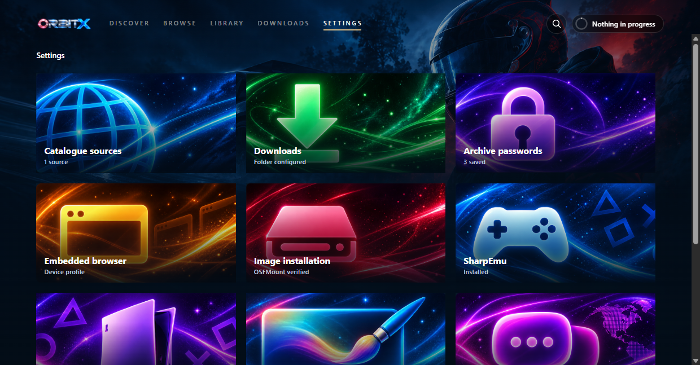
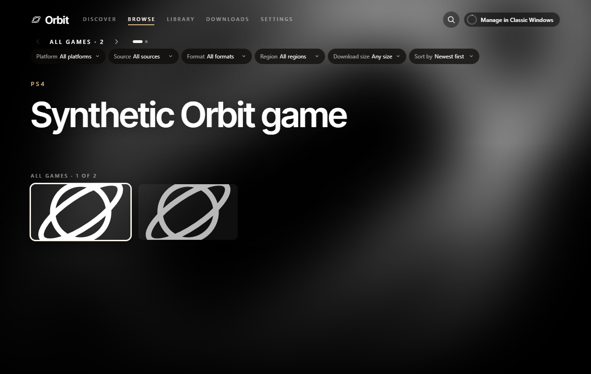
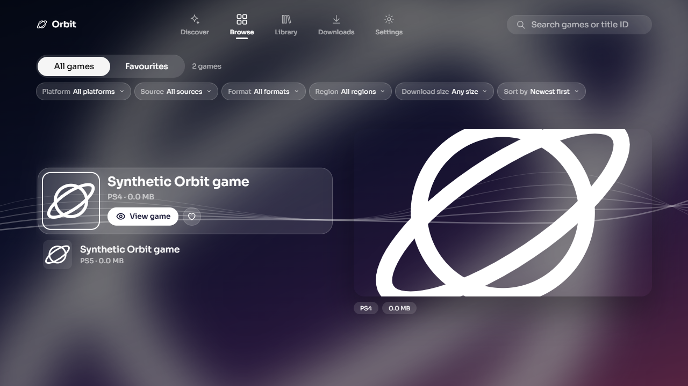
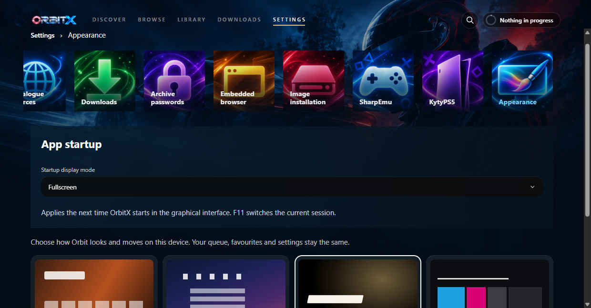

# OrbitX

**OrbitX is an independent Windows adaptation of the [Orbit Store](https://github.com/saawant12/orbit-store-ps5) frontend by [saawant12](https://github.com/saawant12) and its contributors, based on [v1.3.5](https://github.com/saawant12/orbit-store-ps5/releases/tag/v1.3.5).** Credit for the original frontend, layouts and design belongs to the Orbit Store contributors. OrbitX adds a separate WPF backend, Windows management features and emulator integrations; it is not an official Orbit Store release and is not affiliated with or endorsed by the upstream project.


A Windows game library, catalogue browser and download manager with KytyPS5 and SharpEmu integration. Built with .NET 10, WPF and an embedded React interface powered by WebView2.

## Downloads

Get the Windows x64 preview build and matching source ZIP from [GitHub Releases](https://github.com/revvinsuno-sys/OrbitX/releases). Extract the Windows ZIP and run `OrbitX.exe` inside its `OrbitX` folder. Install the .NET 10 Desktop Runtime and Microsoft Edge WebView2 Evergreen Runtime separately. The first release is a **prerelease** with the validation limitations below; Node.js is required for building from source, not for running the Windows package.

## Features

- Browse and search configured catalogues, with artwork and release details.
- Manage direct and browser-assisted downloads, integrity checks and resumable transfers.
- Install supported packages and archives into a local library.
- Configure and launch KytyPS5 or SharpEmu, and view official and local compatibility results.
- Choose Store, Cinema, Crossbar or Panorama layouts, or the Classic Windows interface.
- Configure optional IGDB artwork, screenshots and trailers using your own credentials.

OrbitX is a frontend; emulator support determines whether a game runs. It does not connect to a console. No games, emulator binaries, catalogue decoding keys or IGDB credentials are bundled.

## Screenshots

The following captures use isolated test settings and synthetic catalogue entries, without personal library data or credentials.

### Settings



### Cinema layout



### Crossbar layout



The layout captures show an earlier interface revision. The Settings capture is generated from the current application.

### Appearance controls



## Build and run

Requirements: Windows, the .NET 10 SDK, Node.js 22 with npm, and the Microsoft Edge WebView2 Evergreen Runtime. The first build needs internet access to restore NuGet and locked npm dependencies.

```powershell
dotnet build .\PS5CatalogBrowser.slnx -c Release
.\PS5CatalogBrowser.App\bin\Release\net10.0-windows\OrbitX.exe
```

The application build runs `UI/build-frontend.ps1`, verifies the pinned upstream frontend, and builds the Windows adapter. The upstream package's standalone build command is not the Windows application build.

Select **Interface → Orbit Store** for the graphical interface. **F2** opens Appearance, **F11** toggles fullscreen, and **Escape** goes back. See the [user guide](docs/user-guide.md) for catalogue setup, download workflows, installation formats and emulator configuration.

## IGDB credentials and local data

Enter your own client ID and client secret in **Settings → Metadata**. They are optional; the application builds without them. The client secret is protected using Windows DPAPI for the current Windows user. Settings are stored in `%LOCALAPPDATA%\PS5CatalogBrowser\settings.json`, outside this repository. Access tokens remain in memory.

OrbitX accepts only credentials entered explicitly in its own Settings. It does not import credentials from environment variables, environment files or other applications. Older automatically imported credentials are cleared on startup; explicitly saved OrbitX credentials are preserved. Never commit environment files, settings backups, browser profiles, credentials or decoding keys. Ignore rules cover common secret files and generated outputs; review staged files before committing.

## Validation

```powershell
dotnet run --project .\PS5CatalogBrowser.Tests -c Release
dotnet run --project .\PS5CatalogBrowser.BrowserTests -c Release -- --settings-navigation
```

Both projects are executable test runners and return a nonzero exit code on failure. Browser tests require a Windows desktop and WebView2. The Settings check uses temporary test settings. Other browser checks and their scope are described in the [user guide](docs/user-guide.md) and [frontend validation notes](docs/orbit-frontend-validation.md). Automated results do not establish physical controller or in-game compatibility.

Release validation (23 October 2026): the Release build and full Core runner pass. The compatibility test now checks older builds, newer builds and different commits from the same day against the existing version-comparison contract. Graphical/native Settings and real child-process argument checks pass. Run the browser runner through `dotnet run` or its generated `.exe`; its child-process fixtures require the application's executable host.

The broader browser checks are not green: the old cover-grid/preview assertions target earlier library presentation, the installation end-to-end test fails when preparing a repeat installation of an already-installed fixture, and the browser-download test fails its combined confirmation-count/byte assertion. These failures remain unresolved; neither their resolution nor full browser-suite acceptance is claimed. Physical controller input, real game execution and live provider compatibility are also outside this release's automated acceptance. The initial binary is therefore published as a prerelease.

## Publish a Windows build

For a distributable binary and matching corresponding-source archive, use a clean committed checkout:

```powershell
pwsh -File scripts/Publish-OrbitX.ps1
```

Publish both generated ZIPs together. See [distribution instructions](DISTRIBUTING.md) for the source-access and notice requirements. A standalone local publish is also available:

```powershell
dotnet publish .\PS5CatalogBrowser.App\PS5CatalogBrowser.App.csproj -c Release -r win-x64 --self-contained false -o .\artifacts\OrbitX
```

Distribute the complete output folder. Users need the .NET 10 Desktop Runtime and WebView2 Runtime for this framework-dependent build. Emulator executables and personal settings are configured separately. Generated publish output is ignored by Git.

## Source and licences

OrbitX's combined application is distributed under **GNU GPL version 3 (GPL-3.0-only)**. See the root [licence](LICENSE), [copyright and modification notice](NOTICE.md) and [OrbitX third-party notices](THIRD-PARTY-NOTICES.md). Third-party files retain their original licences; the emulator patches are separately licensed. Normal build/publish output includes the licence texts and notices, and the release script pairs the build with source from the same commit.

The pinned Orbit frontend is GPL-3.0-or-later; see its [licence](UI/orbit-upstream/LICENSE), [third-party notices](UI/orbit-upstream/THIRD-PARTY-NOTICES.md) and [Windows integration provenance](docs/orbit-frontend.md). Package reader components retain their [LibOrbisPkg licence](ThirdParty/LibOrbisPkg/LICENSE.txt), [LibProsperoPkg licence](ThirdParty/LibProsperoPkg/LICENSE) and [notices](ThirdParty/LibProsperoPkg/NOTICE). Preserve these files when distributing source or builds and satisfy the applicable source-distribution obligations. Catalogue data, artwork and game files have separate rights and are not licensed by this repository.

## Bringing in upstream updates

OrbitX imports a pinned subset of Orbit Store's release source into `UI/orbit-upstream`, with Windows integration code in `UI/windows-adapter`. The imported upstream files retain their original bytes. [UI/provenance.json](UI/provenance.json) records v1.3.5, source commit `8043189a7d319be3ffdf828e08bf5a0f105a30fd`, source URLs and archive hashes; [UI/upstream-files.json](UI/upstream-files.json) records each imported file's SHA-256.

This is an independent repository containing an adapted frontend, rather than a GitHub fork with shared Git history. The upstream public repository's `main` contains guides, release information and catalogue assets; the frontend source used here comes from its release source bundle. Updates therefore use a reviewed source import, rather than GitHub's **Sync fork** or an automatic merge of upstream `main`.

1. Select an official Orbit Store release source bundle. Verify its published archive SHA-256 and the inner source archive against the release's checksums, and record the release URL and source commit.
2. Review frontend, API, layout, dependency and licence changes. Import only the required frontend/build files and notices, preserving exact bytes. Keep credentials, decoding keys, feeds, PS5 backend code and commercial artwork out of the import.
3. Update `UI/provenance.json` and regenerate `UI/upstream-files.json`. Review and adjust the Windows adapter and build substitutions for the new source contracts.
4. Run `UI/verify-upstream.ps1` and `UI/build-frontend.ps1 -Restore`, then the Core/Browser tests and Debug/Release builds. Verify all four layouts, native management actions, navigation, restart, fullscreen and input behaviour; review licence and notice changes before distribution.
5. Capture appropriate UI evidence, remove temporary source archives and validation folders, and commit the reviewed source import, adapter changes and provenance together.

See the [full upgrade procedure](docs/orbit-frontend.md#upgrade-procedure) for validation and import boundaries. Catalogue refreshes are a separate runtime feature and do not update application source.
